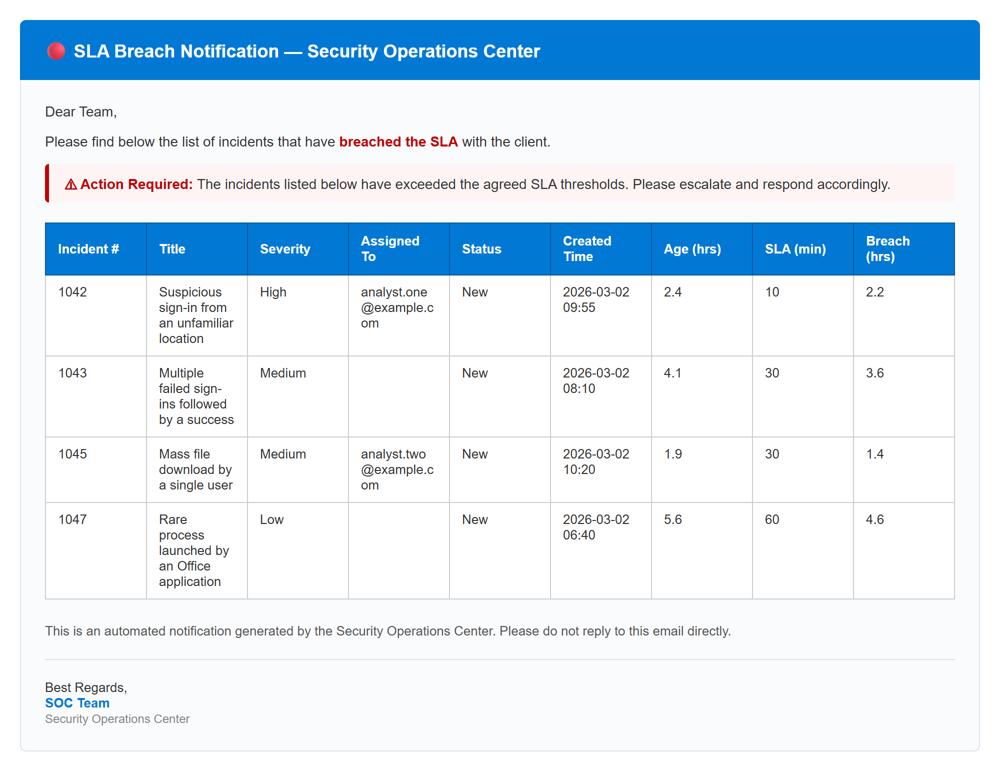
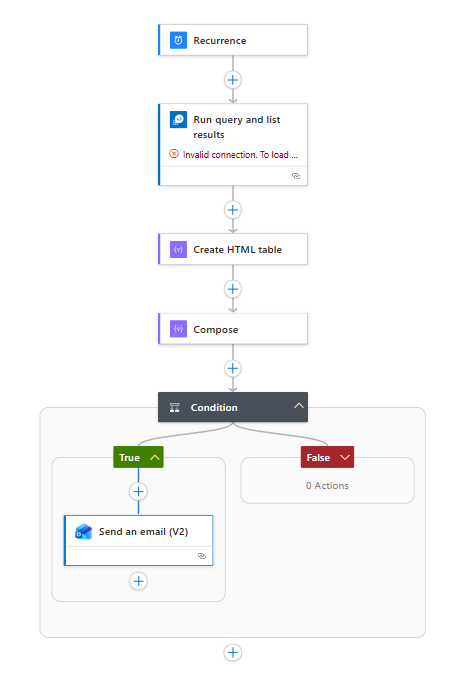
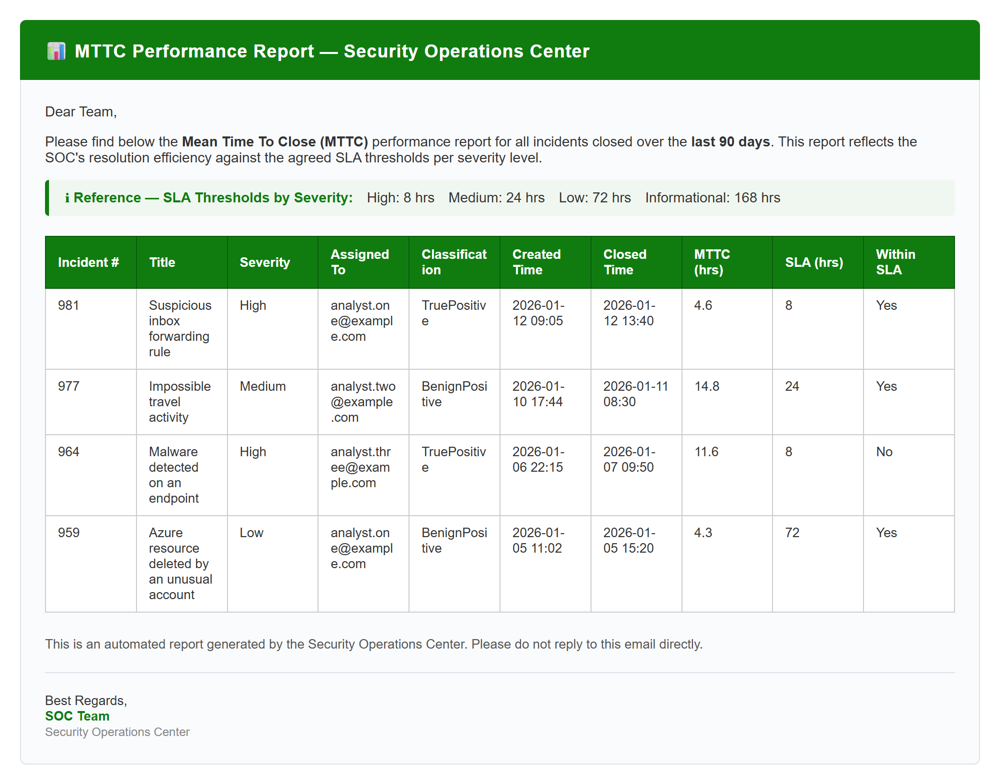

## Overview

In a Security Operations Centre, measuring how fast incidents are handled matters as much as detecting them in the first place. Two of the most important performance indicators are:

- **MTTT, Mean Time To Triage:** how quickly the SOC acknowledges an incident and starts investigating it.
- **MTTC, Mean Time To Close:** how quickly the SOC fully resolves and closes an incident.

Microsoft Sentinel stores the whole incident lifecycle in the `SecurityIncident` table. That makes it possible to calculate both metrics directly with KQL and to automate SLA breach notifications with playbooks.

## Mean Time To Triage playbook

### What it measures

MTTT is the time between the moment an incident is **created** in Sentinel and the moment an analyst **first acknowledges** it by changing its status.

It reflects how **responsive** the SOC team is, and it is usually the first SLA target to meet once an incident is generated.

### Typical SLA targets

| Severity | MTTT target |
| --- | --- |
| High | 10 minutes |
| Medium | 30 minutes |
| Low | 60 minutes |
| Informational | 24 hours |

> These values are indicative. Adjust them to your contractual obligations. Sentinel incidents use four severities (High, Medium, Low, Informational), so the targets and the queries below cover those four.

### How it works

Because MTTT is central to SLA monitoring for SOCs and MSSPs, the playbook sends an email whenever an SLA has been breached.

A recurrence trigger runs every 5 to 10 minutes and queries the Log Analytics workspace for incidents that are still new after their SLA limit, using the KQL query below.

```kql
SecurityIncident
| summarize arg_max(LastModifiedTime, *) by IncidentNumber
| where Status == "New"
| extend
    AgeMinutes = datetime_diff("minute", now(), CreatedTime),
    AgeHours   = round(datetime_diff("second", now(), CreatedTime) / 3600.0, 1)
| extend
    MTTT_SLA_Minutes = case(
        Severity == "High",          10,
        Severity == "Medium",        30,
        Severity == "Low",           60,
        Severity == "Informational", 1440,
        int(null)
    )
| extend
    BreachMinutes = AgeMinutes - MTTT_SLA_Minutes,
    BreachHours   = round((AgeMinutes - MTTT_SLA_Minutes) / 60.0, 1)
| where BreachMinutes > 0
| project
    ["Incident #"]      = IncidentNumber,
    ["Title"]           = Title,
    ["Severity"]        = Severity,
    ["Assigned To"]     = tostring(parse_json(Owner).userPrincipalName),
    ["Status"]          = Status,
    ["Created Time"]    = format_datetime(CreatedTime, 'yyyy-MM-dd HH:mm'),
    ["Age (hrs)"]       = AgeHours,
    ["SLA (min)"]       = MTTT_SLA_Minutes,
    ["Breach (hrs)"]    = BreachHours
| order by
    case(Severity == "High", 0, Severity == "Medium", 1, 2) asc,
    ['Breach (hrs)'] desc
```

The query output goes into a **Create HTML table** action, followed by a **Compose** action that builds the escalation email. The email body is:

```html
<div style="font-family:Arial,sans-serif;font-size:14px;color:#333333;max-width:960px;margin:auto;padding:20px;">

  <div style="background-color:#0078D4;padding:18px 24px;border-radius:6px 6px 0 0;">
    <h2 style="margin:0;color:#ffffff;font-size:18px;">🔴 SLA Breach Notification — Security Operations Center</h2>
  </div>

  <div style="border:1px solid #dde3ea;border-top:none;border-radius:0 0 6px 6px;padding:24px;background-color:#f9fbfd;">

    <p style="margin-top:0;">Dear Team,</p>
    <p>Please find below the list of incidents that have <strong style="color:#c00000;">breached the SLA</strong> with the client.</p>

    <div style="background-color:#fff4f4;border-left:4px solid #c00000;padding:10px 16px;margin-bottom:20px;border-radius:4px;">
      <strong style="color:#c00000;">⚠ Action Required:</strong> The incidents listed below have exceeded the agreed SLA thresholds. Please escalate and respond accordingly.
    </div>

    <style>
      table { border-collapse: collapse; width: 100%; max-width: 100%; table-layout: fixed; font-family: Arial, sans-serif; font-size: 13px; }
      th { background-color: #0078D4; color: #ffffff; padding: 10px 12px; border: 1px solid #005a9e; text-align: left; word-wrap: break-word; overflow-wrap: break-word; }
      td { padding: 9px 12px; border: 1px solid #cccccc; vertical-align: top; background-color: #ffffff; color: #333333; word-wrap: break-word; overflow-wrap: break-word; }
    </style>

    @{body('Create_HTML_table')}

    <p style="margin-top:24px;font-size:13px;color:#555555;">This is an automated notification generated by the Security Operations Center. Please do not reply to this email directly.</p>
    <hr style="border:none;border-top:1px solid #dde3ea;margin:20px 0;">
    <p style="margin:0;font-size:13px;">Best Regards,<br>
    <strong style="color:#0078D4;">SOC Team</strong><br>
    <span style="color:#888888;font-size:12px;">Security Operations Center</span></p>

  </div>
</div>
```

The resulting notification looks like this:



*Example notification, rendered with sample data.*

Finally, a **Condition** action makes sure the email is only sent when there are actual breaches, which prevents empty notifications. The overall Logic App playbook looks like this:



## Mean Time To Close playbook

### What it measures

MTTC is the total time from **incident creation** to **closure**, however many status changes happen in between. It covers the full lifecycle of an incident. MTTC is usually calculated monthly or quarterly across all closed incidents, to report on the SOC's capabilities.

### Typical SLA targets

| Severity | MTTC target |
| --- | --- |
| High | 8 hours |
| Medium | 24 hours |
| Low | 72 hours |
| Informational | 7 days |

### How it works

The MTTC playbook follows the same structure as the MTTT Logic App, with these differences:

**Recurrence:** the playbook runs once every three months, because MTTC feeds quarterly reports. Adjust this to the customer's reporting requirements.

**KQL query:** this query calculates MTTC for every incident closed in the last 90 days:

```kql
SecurityIncident
| summarize arg_max(LastModifiedTime, *) by IncidentNumber
| where Status == "Closed"
| where ClosedTime >= ago(90d)
| extend
    MTTC_Minutes = datetime_diff("minute", ClosedTime, CreatedTime),
    MTTC_Hours   = round(datetime_diff("minute", ClosedTime, CreatedTime) / 60.0, 1)
| extend
    MTTC_SLA_Minutes = case(
        Severity == "High",          480,
        Severity == "Medium",        1440,
        Severity == "Low",           4320,
        Severity == "Informational", 10080,
        int(null)
    )
| extend
    WithinSLA = iff(MTTC_Minutes <= MTTC_SLA_Minutes, "Yes", "No")
| project
    ["Incident #"]      = IncidentNumber,
    ["Title"]           = Title,
    ["Severity"]        = Severity,
    ["Assigned To"]     = tostring(parse_json(Owner).userPrincipalName),
    ["Classification"]  = Classification,
    ["Created Time"]    = format_datetime(CreatedTime, 'yyyy-MM-dd HH:mm'),
    ["Closed Time"]     = format_datetime(ClosedTime, 'yyyy-MM-dd HH:mm'),
    ["MTTC (hrs)"]      = MTTC_Hours,
    ["SLA (hrs)"]       = MTTC_SLA_Minutes / 60,
    ["Within SLA"]      = WithinSLA
```

**Email body:** the MTTC report email uses this template:

```html
<div style="font-family:Arial,sans-serif;font-size:14px;color:#333333;max-width:960px;margin:auto;padding:20px;">
  <div style="background-color:#107C10;padding:18px 24px;border-radius:6px 6px 0 0;">
    <h2 style="margin:0;color:#ffffff;font-size:18px;letter-spacing:0.5px;">📊 MTTC Performance Report — Security Operations Center</h2>
  </div>
  <div style="border:1px solid #dde3ea;border-top:none;border-radius:0 0 6px 6px;padding:24px;background-color:#f9fbfd;">
    <p style="margin-top:0;">Dear Team,</p>
    <p>Please find below the <strong>Mean Time To Close (MTTC)</strong> performance report for all incidents closed over the <strong>last 90 days</strong>. This report reflects the SOC's resolution efficiency against the agreed SLA thresholds per severity level.</p>
    <div style="background-color:#f0f7f0;border-left:4px solid #107C10;padding:10px 16px;margin-bottom:20px;border-radius:4px;">
      <strong style="color:#107C10;">ℹ Reference — SLA Thresholds by Severity:</strong>
      <span style="margin-left:10px;">High: 8 hrs</span>
      <span style="margin-left:10px;">Medium: 24 hrs</span>
      <span style="margin-left:10px;">Low: 72 hrs</span>
      <span style="margin-left:10px;">Informational: 168 hrs</span>
    </div>
    <style>
      table { border-collapse: collapse; width: 100%; max-width: 100%; table-layout: fixed; font-family: Arial, sans-serif; font-size: 13px; }
      th { background-color: #107C10; color: #ffffff; padding: 10px 12px; border: 1px solid #0a5c0a; text-align: left; word-wrap: break-word; }
      td { padding: 9px 12px; border: 1px solid #cccccc; vertical-align: top; background-color: #ffffff; color: #333333; word-wrap: break-word; overflow-wrap: break-word; }
    </style>
    @{body('Create_HTML_table')}
    <p style="margin-top:24px;font-size:13px;color:#555555;">This is an automated report generated by the Security Operations Center. Please do not reply to this email directly.</p>
    <hr style="border:none;border-top:1px solid #dde3ea;margin:20px 0;">
    <p style="margin:0;font-size:13px;">
      Best Regards,<br>
      <strong style="color:#107C10;">SOC Team</strong><br>
      <span style="color:#888888;font-size:12px;">Security Operations Center</span>
    </p>
  </div>
</div>
```



*Example report, rendered with sample data.*

## KQL queries for dashboards and workbooks

These queries are meant for Microsoft Sentinel workbooks, to visualize SLA performance for both MTTT and MTTC.

### 1. SLA compliance by severity (bar chart)

```kql
SecurityIncident
| summarize arg_max(LastModifiedTime, *) by IncidentNumber
| where Status == "Closed"
| where CreatedTime >= ago(30d)
| extend MTTC_Minutes = datetime_diff("minute", ClosedTime, CreatedTime)
| extend MTTC_SLA_Minutes = case(
    Severity == "High",          480,
    Severity == "Medium",        1440,
    Severity == "Low",           4320,
    Severity == "Informational", 10080,
    int(null))
| summarize
    TotalIncidents = count(),
    WithinSLA      = countif(MTTC_Minutes <= MTTC_SLA_Minutes),
    BreachedSLA    = countif(MTTC_Minutes > MTTC_SLA_Minutes)
    by Severity
| extend SLA_Compliance_Pct = round(100.0 * WithinSLA / TotalIncidents, 1)
| project Severity, SLA_Compliance_Pct
| render barchart
    with (title="SLA Compliance % by Severity", ytitle="Compliance %", xtitle="Severity")
```

### 2. Overall SLA compliance (pie chart)

```kql
SecurityIncident
| summarize arg_max(LastModifiedTime, *) by IncidentNumber
| where Status == "Closed"
| where CreatedTime >= ago(30d)
| extend MTTC_Minutes = datetime_diff("minute", ClosedTime, CreatedTime)
| extend MTTC_SLA_Minutes = case(
    Severity == "High",          480,
    Severity == "Medium",        1440,
    Severity == "Low",           4320,
    Severity == "Informational", 10080,
    int(null))
| extend SLAResult = iff(MTTC_Minutes <= MTTC_SLA_Minutes, "Within SLA", "Breached")
| summarize Count = count() by SLAResult
| render piechart
    with (title="Overall SLA Compliance — Last 30 Days")
```

### 3. Average MTTC against the SLA target (bar chart)

```kql
SecurityIncident
| summarize arg_max(LastModifiedTime, *) by IncidentNumber
| where Status == "Closed"
| where CreatedTime >= ago(30d)
| extend MTTC_Minutes = datetime_diff("minute", ClosedTime, CreatedTime)
| extend MTTC_SLA_Minutes = case(
    Severity == "High",          480,
    Severity == "Medium",        1440,
    Severity == "Low",           4320,
    Severity == "Informational", 10080,
    int(null))
| summarize
    ["Avg MTTC (hrs)"] = round(avg(MTTC_Minutes) / 60.0, 1),
    ["SLA Target (hrs)"] = round(avg(MTTC_SLA_Minutes) / 60.0, 1)
    by Severity
| render barchart
    with (title="Avg MTTC vs SLA Target by Severity", ytitle="Hours", xtitle="Severity", kind=unstacked)
```

### 4. Closed incidents by severity (pie chart)

```kql
SecurityIncident
| summarize arg_max(LastModifiedTime, *) by IncidentNumber
| where Status == "Closed"
| where CreatedTime >= ago(30d)
| summarize TotalIncidents = count() by Severity
| render piechart
    with (title="Closed Incidents Distribution by Severity — Last 30 Days")
```
