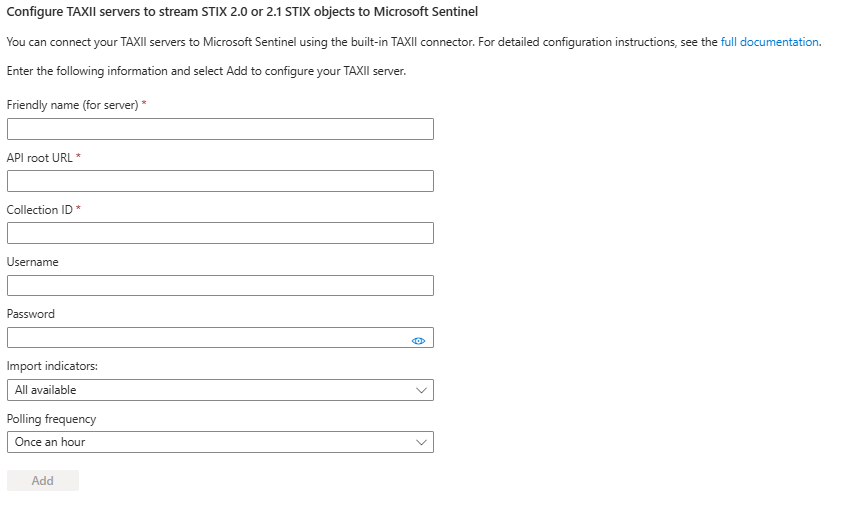

## What TAXII gives you

STIX is the format most threat intelligence providers use to describe indicators: IP addresses, domains, URLs and file hashes, with context such as when they were seen and how confident the provider is. TAXII is the protocol that serves them. Microsoft Sentinel has a built-in TAXII client, the **Threat Intelligence - TAXII** data connector, which polls a TAXII 2.0 or 2.1 server on a schedule and stores the indicators in your workspace. From there, analytics rules can match them against your sign-in, DNS, firewall and proxy logs.

Two free feeds work with it: AlienVault OTX and Pulsedive. This guide covers the settings for both, how to check that the indicators arrived, and what to connect next. If you are choosing a full threat intelligence platform, see [my comparison of open-source and commercial TIPs](/writing/threat-intel-platforms-compared/).

## Install the connector

The connector comes with the **Threat Intelligence** solution in the Content hub:

1. In Microsoft Sentinel, open **Content hub**, search for **Threat Intelligence**, and install the solution.
2. Go to **Data connectors**, select **Threat Intelligence - TAXII**, and open the connector page.

Both steps work in the Defender portal and the Azure portal. Microsoft has said Sentinel will only be supported in the Defender portal after 31 March 2027, so set up anything new there.

Each feed you add is one entry in the connector's form:



- **Friendly name:** any name you will recognise later.
- **API root URL** and **Collection ID:** where the server keeps the feed. Both come from the provider.
- **Username** and **Password:** only if the provider requires them.
- **Import indicators** and **Polling frequency:** how far back to import on the first run, and how often to check for new indicators.

## AlienVault OTX

OTX (Open Threat Exchange) is a community platform where researchers share threat data as "pulses". It is now run by LevelBlue. The `user_AlienVault` collection holds the pulses published by the AlienVault team itself, and it is public, so you don't need an account:

| Field | Value |
| --- | --- |
| Friendly name | AlienVaultOTX |
| API root URL | `https://otx.alienvault.com/taxii/root/` |
| Collection ID | `user_AlienVault` |
| Username and password | Leave empty |

Two things to know:

- **Older forum posts say OTX only supports TAXII 1.x and doesn't work with Sentinel.** That is out of date. When I checked in November 2026, the server answered as a TAXII 2.1 server and served this collection without credentials.
- **Don't import everything.** The collection goes back to 2015, so "All available" pulls in years-old indicators. IP addresses and domains change hands, and old ones are a steady source of false positives. Choose a shorter import window.

## Pulsedive

Pulsedive is a threat intelligence platform with a free tier and a TAXII 2.1 server. Every request needs an API key, which you get by creating a free account:

| Field | Value |
| --- | --- |
| Friendly name | PulsediveIOC |
| API root URL | `https://pulsedive.com/taxii2/api/` |
| Collection ID | `981c4916-ebb2-4567-aece-54ae970c4230` |
| Username | `taxii2` |
| Password | Your Pulsedive API key |

That collection ID is the free test collection, which Pulsedive describes as live sample data. The full indicator collection (`a5cffbfe-c0ff-4842-a235-cb3a7a040a37`) and threat collection (`dc9ecfa5-7769-4cf3-b699-38a9776b431d`) need a Pro or Feed plan. Pulsedive's documentation also lists a discovery URL, `https://pulsedive.com/taxii2/`, but the Sentinel form doesn't ask for it.

Treat the API key like a password. It is stored in the connector, so use a key from an account created for this purpose, and rotate it if it leaks.

## Check that the indicators arrived

Microsoft says indicators should start flowing within a few minutes. If you set polling to once an hour, allow up to an hour for the first batch. The connector page lists each server you added, with the time the last indicator was received.

To see what arrived, query the `ThreatIntelIndicators` table. It replaced the legacy `ThreatIntelligenceIndicator` table, which stopped receiving new data in 2025, so older queries and workbooks built on the legacy table won't show your new feeds.

```kql
// indicators ingested in the last day, by source and type
ThreatIntelIndicators
| where TimeGenerated > ago(1d)
| summarize arg_max(TimeGenerated, *) by Id
| where IsDeleted == false
| extend Source = base64_decode_tostring(tostring(split(Id, "---")[0]))
| extend Type = tostring(split(ObservableKey, ":")[0])
| summarize Indicators = count(), LastIngested = max(TimeGenerated) by Source, Type
| order by Source asc, Indicators desc
```

Each `Id` starts with the indicator's source, base64-encoded, followed by `---` and the STIX ID. The query decodes that first part to show where each indicator came from, and takes the indicator type (such as `ipv4-addr`, `domain-name` or `url`) from `ObservableKey`.

## Put the indicators to work

Indicators sitting in a table don't detect anything. The Threat Intelligence solution includes analytics rule templates that match indicators against your logs by type: IP address, domain, URL, file hash and email. Enable the ones that fit the data you collect, such as IP indicators against sign-in logs, or domains and URLs against DNS and proxy logs.

Free feeds are noisy. Review the alerts from the first week, and tune or turn off rules that fire mostly on stale or low-confidence indicators.

## Beyond free feeds

- **MISP:** push indicators to Sentinel through the Threat Intelligence Upload API, using MISP2Sentinel.
- **OpenCTI:** use its dedicated Sentinel connector, or let Sentinel poll OpenCTI as a TAXII 2.1 server.
- **Commercial feeds:** most offer TAXII 2.1 or the Upload API. The older Threat Intelligence Platforms connector is deprecated, and Microsoft said it would stop collecting data in June 2026, so don't build anything new on it.
- **Enrichment:** during investigations, I use Azure Logic Apps playbooks to look up indicators in abuse.ch services such as MalwareBazaar, and in VirusTotal.

## Sources

- [Connect Microsoft Sentinel to STIX/TAXII threat intelligence feeds (Microsoft Learn)](https://learn.microsoft.com/en-us/azure/sentinel/connect-threat-intelligence-taxii)
- [Threat intelligence in Microsoft Sentinel (Microsoft Learn)](https://learn.microsoft.com/en-us/azure/sentinel/understand-threat-intelligence)
- [Work with STIX objects and indicators (Microsoft Learn)](https://learn.microsoft.com/en-us/azure/sentinel/work-with-stix-objects-indicators)
- [ThreatIntelIndicators table reference (Microsoft Learn)](https://learn.microsoft.com/en-us/azure/azure-monitor/reference/tables/threatintelindicators)
- [Threat intelligence integration in Microsoft Sentinel (Microsoft Learn)](https://learn.microsoft.com/en-us/azure/sentinel/threat-intelligence-integration)
- [Connect your threat intelligence platform to Microsoft Sentinel (Microsoft Learn)](https://learn.microsoft.com/en-us/azure/sentinel/connect-threat-intelligence-tip)
- [TAXII quick setup (Pulsedive documentation)](https://docs.pulsedive.com/taxii/quick-setup)
- [Import Pulsedive feed into Microsoft Sentinel (Microsoft Tech Community, 2022)](https://techcommunity.microsoft.com/blog/microsoftsentinelblog/import-pulsedive-feed-into-microsoft-sentinel/3478953)
- [AlienVault OTX TAXII feed (Microsoft Tech Community discussion)](https://techcommunity.microsoft.com/discussions/microsoftsentinel/alienvault-otx-taxii-feed/1877695)
